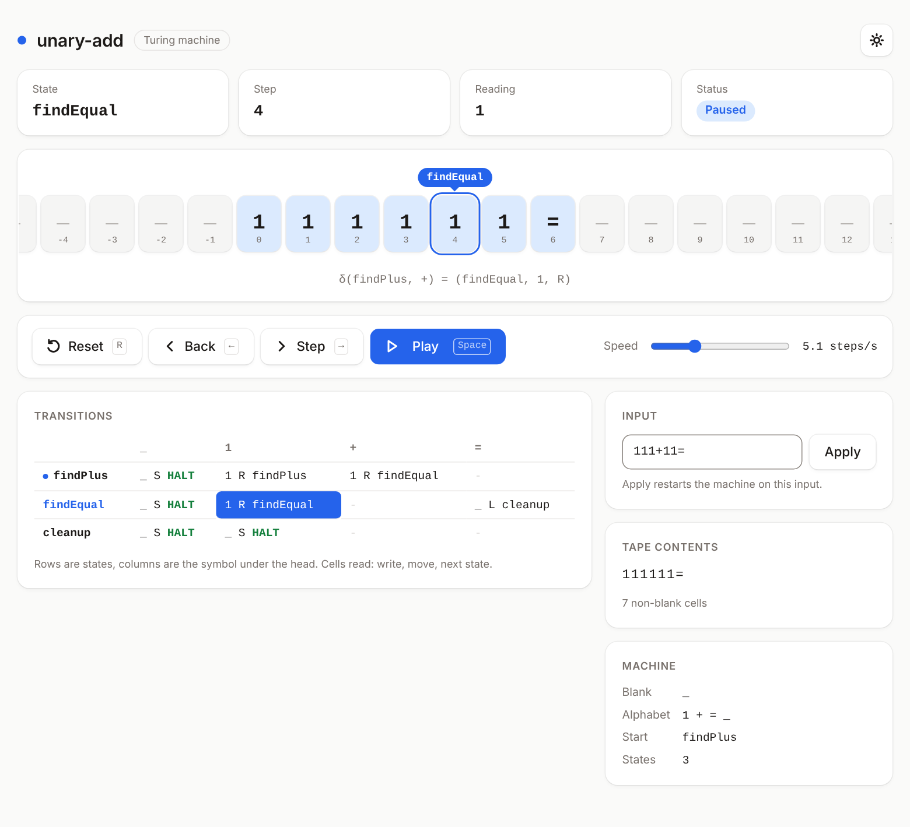
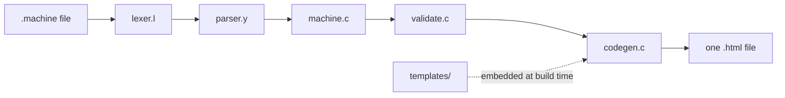

<div align="center">



# MachineSim

**Write a Turing machine in a few lines. Get one HTML file that runs it.**

[](https://github.com/Pixelrick420/MachineSim/actions/workflows/ci.yml)
[](#license)


[Quick start](#quick-start) · [Language](docs/language.md) · [Examples](#examples) · [How it works](docs/architecture.md) · [Contributing](CONTRIBUTING.md)

</div>

<picture>
  <source media="(prefers-color-scheme: dark)" srcset="docs/screenshot-dark.png">
  
</picture>

MachineSim is a compiler. You describe a machine in a small language, and it
writes a single, self-contained HTML page that animates the machine running.
The page has no dependencies and fetches nothing, so it works from `file://`,
an email attachment or a USB stick, and you can hand it to someone who has
never heard of Turing machines.

## Contents

- [Features](#features)
- [Quick start](#quick-start)
- [Your first machine](#your-first-machine)
- [The page](#the-page)
- [Language at a glance](#language-at-a-glance)
- [Examples](#examples)
- [How it works](#how-it-works)
- [Project structure](#project-structure)
- [Development](#development)
- [License](#license)

## Features

- **One file out.** CSS, JavaScript, icons and data are all inlined. Share it,
  host it or open it offline.
- **Real error messages.** Mistakes are reported as `file:line: error: ...`:
  undefined states, symbols outside the alphabet, duplicate transitions and more.
  Unreachable states get a warning.
- **Fast engine.** At *max* speed the 47-million step busy beaver finishes in
  about two seconds in the page.
- **Step back.** Undo up to a million steps, exactly, not by replaying.
- **Edit and rerun.** Change the input in the page without recompiling.
- **Light and dark themes**, keyboard shortcuts, a mobile layout and support for
  reduced motion.
- **Small.** A C compiler, four template files and no runtime dependencies.

## Quick start

You need `gcc`, `make`, `flex` and `bison`. Node.js is only needed to run the
tests.

```sh
# Debian and Ubuntu
sudo apt install build-essential flex bison

# macOS
brew install flex bison
```

Build the compiler and try an example:

```sh
git clone https://github.com/Pixelrick420/MachineSim.git
cd MachineSim

make                       # builds bin/turing-compiler
make build-all             # writes dist/<example>.html for every example
open dist/unary-add.html   # xdg-open on Linux, or just double click it
```

No server is needed.

## Your first machine

Save this as `flip.machine`. It inverts every bit of a binary string and stops
at the first blank:

```
// flip.machine
BLANK    : _;
ALPHABET : { 0 , 1 , _ };
START    : flip;

STATE flip : {
    0 : { WRITE : 1 , MOVE : RIGHT , NEXT : flip } ;
    1 : { WRITE : 0 , MOVE : RIGHT , NEXT : flip } ;
    _ : { NEXT : HALT } ;
} ;

INPUT : 10110;
```

Compile it and open the page:

```sh
./bin/turing-compiler -o flip.html flip.machine
```

Press <kbd>Space</kbd> to play, or <kbd>→</kbd> to take one step at a time. The
tape ends as `01001` after 6 steps. Without `-o` the page goes to standard
output instead:

```sh
./bin/turing-compiler flip.machine > flip.html
```

If the file has a mistake, nothing is written and the exit status is 1. Here the
first transition has a typo, `flp`:

```
flip.machine:7: error: state 'flip' jumps to undefined state 'flp'
```

## The page

| Control | What it does |
| --- | --- |
| **Play / Pause** | Run the machine continuously. <kbd>Space</kbd> |
| **Step** | Take one step. <kbd>→</kbd> |
| **Back** | Undo one step, up to a million. <kbd>←</kbd> |
| **Reset** | Return to step 0 on the current input. <kbd>R</kbd> |
| **Speed** | 0.5 steps per second up to *max*. |
| **Input** | Type a new tape and press Apply. A symbol outside the alphabet is rejected with a message. |
| **Theme** | Switch between light and dark. Your choice is remembered. |

The tape slides under a fixed head. The state label sits above it, the
transition that just ran is highlighted in the table, and a cell flashes when
its symbol changes. The status reads *Ready*, *Running*, *Paused*, *Halted*,
*Stuck* (no transition for the symbol under the head) or *Tape limit*.

Shortcuts are ignored while the input box or a button has focus.

## Language at a glance

```
BLANK    : _;                        // the empty symbol
ALPHABET : { 1 , + , = , _ };        // every symbol the machine uses
START    : findPlus;                 // where to begin
STATE findPlus : {
    1 : { WRITE : 1 , MOVE : RIGHT , NEXT : findPlus } ;
    + : { WRITE : 1 , MOVE : RIGHT , NEXT : findEqual } ;
} ;
INPUT    : 111+11=;                  // the initial tape
```

- A symbol is one ASCII character. Everything after `INPUT :` up to `;` is read
  one character at a time, so `INPUT : abba;` works.
- In a transition every action is optional. `WRITE` keeps the symbol that was
  read, `MOVE` is `STAY` and `NEXT` is `HALT`.
- State names start with a lowercase letter and use letters and digits.
- Statements can come in any order, and `//` starts a comment.

The full reference, with the grammar, every error message and a traced
example, is in [docs/language.md](docs/language.md).

## Examples

All of these live in [`examples/`](examples/) and are run by the test suite.

| Machine | What it does | Result |
| --- | --- | --- |
| [`hello-world`](examples/hello-world.machine) | Two states: overwrite the first cell with `0`, then write a `1` to its left. | `001` becomes `1001` in 2 steps |
| [`binary-increment`](examples/binary-increment.machine) | Adds one to a binary number, carrying leftwards. | `1011` becomes `1100` in 8 steps |
| [`unary-add`](examples/unary-add.machine) | Adds two unary numbers. | `111+11=` leaves five `1`s in 8 steps |
| [`palindrome`](examples/palindrome.machine) | Decides whether a binary string reads the same backwards, writing `1` or `0` left of the input. | `101` is accepted in 17 steps |
| [`busy-beaver`](examples/busy-beaver.machine) | The five state champion, started on a blank tape. | Halts after 47,176,870 steps with 4,098 ones |

Try `busy-beaver` at *max* speed, then use **Back** to walk the end of the run in
reverse.

## How it works



`flex` and `bison` turn the text into a syntax tree. That becomes a machine
model, which is checked and then written into an HTML template. The templates
are compiled into the binary, so the compiler has no files to find at runtime.
The page runs on a small engine that maps symbols and states to integers and
keeps history in a ring buffer, which is why it can run millions of steps per
second and still undo.

[docs/architecture.md](docs/architecture.md) goes through each stage, the data
format and the interface design.

## Project structure

```
include/     lib.h, machine.h, templates.h
src/         lexer.l and parser.y        the language
             machine.c, validate.c       model and semantic checks
             codegen.c, main.c           output and entry point
templates/   index.html, style.css       the page, embedded into the compiler
             engine.js, app.js           the machine and the interface
examples/    sample machines
tests/       check.js, ui.js, errors/    run by make test
docs/        language, architecture, screenshots
scripts/     screenshots.js              regenerates the README images
```

## Development

| Command | What it does |
| --- | --- |
| `make` | Build `bin/turing-compiler`. |
| `make test` | Compile the examples, then run `tests/check.js` and `tests/ui.js`. |
| `make build-all` | Compile every example to `dist/<name>.html`. |
| `make build-example EXAMPLE=palindrome` | Compile one example. |
| `make install` | Copy the compiler to `/usr/local/bin`. |
| `make clean` | Remove build output. |

The tests run every example through the same engine the page uses, check the
error cases, and lint the generated page for its interface rules. See
[CONTRIBUTING.md](CONTRIBUTING.md) for how to add an example, a diagnostic or a
change to the interface.

## License

MIT
