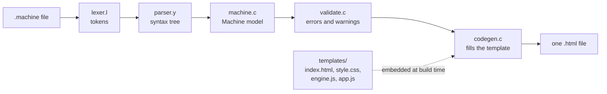

# Architecture

MachineSim is a compiler with one job: read a machine definition and write one
HTML file that can run it. This document explains how the pieces fit together,
for anyone changing the compiler or the page it produces.

- [The pipeline](#the-pipeline)
- [Compiler stages](#compiler-stages)
- [From templates to a single file](#from-templates-to-a-single-file)
- [The machine data](#the-machine-data)
- [The page at runtime](#the-page-at-runtime)
- [Interface rules](#interface-rules)
- [Tests](#tests)

## The pipeline



Everything left of the template is classic compiler work in C, built with
`flex` and `bison`. Everything the browser runs lives in `templates/` and is
plain JavaScript and CSS with no dependencies and no build step of its own.

## Compiler stages

| Stage | File | What it does |
| --- | --- | --- |
| Entry point | `src/main.c` | Parses `-o` and the input path, derives the machine name from the file name without its extension, and runs the stages in order. |
| Lexing | `src/lexer.l` | Turns text into tokens. After `INPUT :` it switches to a mode that reads one character at a time, so lower case letters and digits can be tape symbols. |
| Parsing | `src/parser.y` | Builds a syntax tree from the grammar. Syntax errors are reported by Bison with the offending token and what was expected. |
| Tree | `src/lib.c`, `include/lib.h` | The syntax tree node type, plus `reportError` and `reportWarning`, which print `file:line: error: text`. |
| Model | `src/machine.c`, `include/machine.h` | Walks the tree into a `Machine`: blank, alphabet, start state, input and a list of states with their rules. Applies the defaults (`WRITE` keeps the symbol, `MOVE` is `STAY`, `NEXT` is `HALT`) and checks that every symbol is a single character. |
| Validation | `src/validate.c` | Semantic checks that need the whole model: duplicate statements and states, symbols outside the alphabet, jumps to undefined states, unreachable states. It reports every problem in one run rather than stopping at the first. |
| Output | `src/codegen.c` | Writes the page: substitutes the machine data and the templates into the HTML skeleton. |

The compiler is deliberately a single pass over a small language. A machine
file is read, checked and written out. Nothing is cached and there is no
intermediate file.

## From templates to a single file

The four files in `templates/` are the whole front end:

| File | Role |
| --- | --- |
| `index.html` | The page skeleton, with `{{PLACEHOLDERS}}`. |
| `style.css` | All styling, including light and dark themes. |
| `engine.js` | The machine itself. Pure logic, no DOM access. |
| `app.js` | Everything that touches the page. |

At build time the `Makefile` turns each of them into a C string constant, so
the compiler is one self-contained binary with no files to find at runtime.
`emitHtml` in `codegen.c` then copies `index.html` and replaces these
placeholders in a single pass:

| Placeholder | Replaced with |
| --- | --- |
| `{{TITLE}}` | The machine name, HTML escaped. |
| `{{STYLE}}` | `style.css` |
| `{{ENGINE}}` | `engine.js` |
| `{{APP}}` | `app.js` |
| `{{DATA}}` | The machine as JSON. |

Because the pass runs once, content that was just substituted is never scanned
again. A `{{` inside a stylesheet or a script cannot be mistaken for a
placeholder.

The result has nothing left to fetch: no `<script src>`, no stylesheet link and
no image. The favicon is a `data:` URI. `tests/check.js` enforces this for
every example, which is why the page works from `file://`, an email attachment
or a USB stick.

## The machine data

The page learns about the machine from a JSON block that the compiler writes
into a `<script id="machine-data" type="application/json">` element. The
`<`, `>` and `&` characters are written as `\u003c`, `\u003e` and `\u0026`, so
the data can never close the script tag early.

```json
{
  "name": "unary-add",
  "blank": "_",
  "alphabet": ["1", "+", "=", "_"],
  "start": "findPlus",
  "input": "111+11=",
  "states": [
    {
      "name": "findPlus",
      "rules": [
        { "read": "1", "write": "1", "next": "findPlus", "move": "RIGHT" },
        { "read": "+", "write": "1", "next": "findEqual", "move": "RIGHT" }
      ]
    }
  ]
}
```

Defaults are already applied, so the page never has to guess: `write` is always
a concrete symbol, `next` is a state name or `"HALT"`, and `move` is one of
`LEFT`, `RIGHT` and `STAY`.

## The page at runtime

### The engine

`engine.js` turns the JSON into a form that is fast to step:

- Symbols and states become small integers. Symbol 0 is always the blank, so a
  zeroed tape is a blank tape.
- Transitions live in flat typed arrays indexed by `state * symbolCount + symbol`,
  so one step is a handful of array reads and writes.
- The tape is a growable typed array centred on the origin. It doubles as the
  head wanders and stops at 2<sup>26</sup> cells, which the page reports as
  *Tape limit*.
- History is a ring buffer of the head position, the state and the symbol that
  was overwritten. Undo costs a fixed amount of memory per step and reaches back
  2<sup>20</sup> steps.

The engine alone runs the 47,176,870 steps of `busy-beaver` in about a second
in Node.

Because the engine has no DOM dependency, `tests/check.js` loads it directly in
Node and runs every example through the same code the page uses.

### The page

`app.js` owns the DOM and nothing else:

- **Tape.** Only the cells near the head exist. Each cell is created when it
  scrolls into range and removed when it leaves, keyed by tape position. The
  whole strip slides by changing one `transform` on a single track element.
- **Transitions table.** Built once from the engine's rules. Each step moves a
  highlight to the current row and cell instead of rebuilding anything.
- **Playback.** A `requestAnimationFrame` loop converts elapsed time into a
  number of steps. Single steps animate only when they are slow enough to see.
  Above about 60 steps per second the page batches steps and draws once per
  frame, and at *max* it runs the engine in 12 millisecond slices.
- **Write highlight.** When a step changes a cell, that cell snaps to a start
  pose and CSS transitions carry it back to rest. See below.

## Interface rules

The page follows the [better-ui](https://www.ui-skills.com/skills/jakubkrehel/better-ui)
principles. These are the rules that shaped the stylesheet, where each one
lives, and what stops it from regressing.

| Rule | Where it lives | Guarded by |
| --- | --- | --- |
| Surfaces get depth from a layered box-shadow ring, not a border. A transparent 1px border stays underneath so forced-colors mode still draws an edge. | `--shadow-border` on `.card`, `.stat`, `.cell`, buttons | Review |
| Borders are kept where they mean structure: inputs, table rows, chips and the selected head frame. Input borders meet 3:1 contrast. | `--input-border`, `.head-frame` | Review |
| Nested radii are concentric: 10px cell + 2px gap + 2px border gives the 14px head frame. | `.head-frame` | Review |
| Icons are SVG drawn with `currentColor` on an 18px grid, so a 2px stroke renders crisp. | `.icon` | `tests/ui.js` |
| Icons that swap on an infrequent change cross-fade: opacity 0 to 1, scale 0.25 to 1, blur 4px to 0, over 300ms. | `.swap`, driven by `--on` | Review |
| Buttons scale to 0.96 on press, never when disabled, with an opt-out via `data-static`. | `button:active` | `tests/ui.js` |
| Hover styles only apply on pointers that can hover. | `@media (hover: hover)` | `tests/ui.js` |
| Transitions name their properties, never `all`. | every `transition-property` | `tests/ui.js` |
| Movement, scale and blur only run under `prefers-reduced-motion: no-preference`. Reduced motion keeps an opacity fade. | `@media (prefers-reduced-motion: no-preference)` | `tests/ui.js` |
| State changes use transitions, because they retarget. Keyframes are kept for sequences that run once, such as the entrance. | `.cell.wrote`, `.error`, `fade-in-up` | Review |
| Enters are staggered by 100ms on first load only. Exits are shorter and smaller than enters. | `.app > *`, `.error` | Review |
| A theme switch disables every transition around the flip, so colors do not smear. | `withoutTransitions` in `app.js` | `tests/ui.js` |

### The write highlight

A cell that was just written needs a flash that fades back to whatever color
that cell rests at, and it must survive being interrupted by the next step.
Keyframes do neither well, so the page uses a transition and a short trick:

```js
el.classList.add('wrote');    // snap to the flash color, transition-duration is 0
void el.offsetWidth;          // commit that state
el.classList.remove('wrote'); // the cell's own transition fades it back to rest
```

Because the end of the fade is simply the cell's normal style, input cells
return to blue and empty cells to grey without the stylesheet naming either.

## Tests

`make test` builds the compiler and runs two scripts with Node, with no
packages to install.

| Script | Checks |
| --- | --- |
| `tests/check.js` | Every example compiles to a standalone page. The example machines produce the right results, including `busy-beaver` at exactly 47,176,870 steps. Undo restores earlier states exactly. A machine with a missing rule gets stuck instead of looping. Every file in `tests/errors/` fails with its expected message. |
| `tests/ui.js` | Lints the generated page against the interface rules marked above. Pass it a compiled page to lint that file instead: `node tests/ui.js page.html`. |

To add a diagnostic test, drop a file in `tests/errors/` whose first line says
what the message must contain, in the form `// expect: text`.
